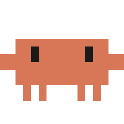
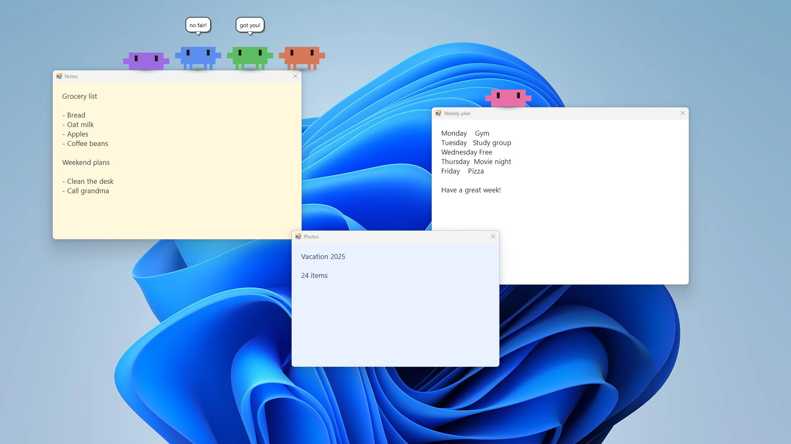
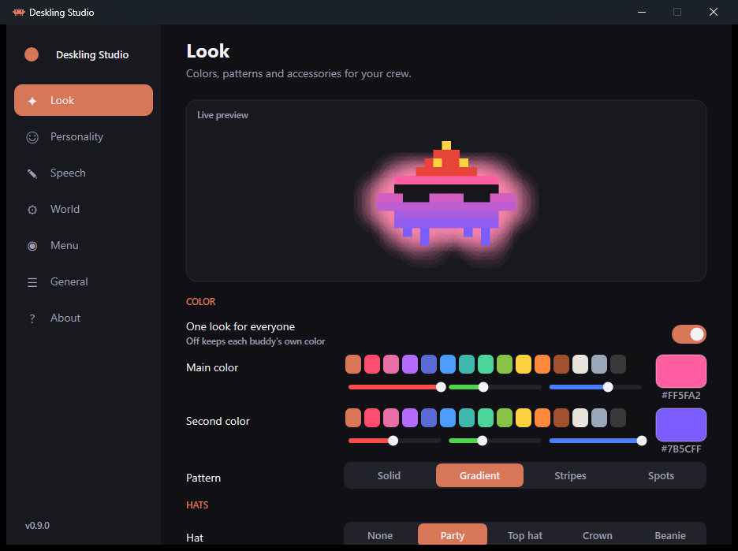

<p align="center"></p>

<h1 align="center">Deskling</h1>

<p align="center"><b>Basically Clawd, living on your Windows desktop.</b><br>Unofficial fan project, not made by or affiliated with Anthropic.</p>

Deskling puts Clawd and up to 199 friends on your screen. They walk on your taskbar and windows, pile up, play tag, draw on your screen and get thrown around. Everything is customizable, and Claude Code can control them.

<!-- Add a GIF demo here:  -->

<p align="center"></p>

<p align="center">
  
  
</p>

- **200 buddies at 60 fps**, drawn on the GPU
- **One small `.exe`** with nothing to install
- **Deskling Studio** to customize looks, personality, physics and the menu
- **Private:** no telemetry, no accounts, no internet ([details](PRIVACY.md))

## Install

1. Download [`deskling.exe`](https://github.com/Zecay/deskling/releases/latest/download/deskling.exe) from the [latest release](https://github.com/Zecay/deskling/releases/latest).
2. Double-click it.

It needs Windows 10 or 11. Windows SmartScreen may warn you because the app isn't code-signed yet. Choose **More info**, then **Run anyway**.

To close it, click **Quit** in Deskling Studio, or right-click a buddy and choose **Studio > Quit**. To start it with Windows, put a shortcut to it in the folder that opens from `Win+R` > `shell:startup`.

## Play with them

| Do this | What happens |
|---|---|
| Drag | Carry a buddy around |
| Flick and let go | Throw it. It bounces, spins and skids |
| Click | Poke it. Five quick pokes make it angry |
| Rub the pointer over it | Hearts |
| Double-click | Backflip |
| Scroll | Bigger or smaller |
| Right-click | Open the menu |

## The menu

Pick a **radial wheel** or a **dropdown panel** in **Studio > Menu**, then change its theme, color, size, opacity and speed.

- Hover to see where a drawing or prop will land.
- Press **P** or middle-click to pin up to 6 favourites. Shift+arrows reorders them.
- Arrow keys, scroll, Enter and Esc all work.
- **Create > Select** lets you drag a box around buddies and command the whole group.

## Deskling Studio

Open it from the menu, or launch the `.exe` again while it's running.

| Page | What you can change |
|---|---|
| **Look** | Colors, gradients, stripes, spots, hats, glasses, your own imported hat and glasses images, trails, glow |
| **Personality** | Energy, chattiness, curiosity, sleepiness, playfulness, chaos, presets |
| **Speech** | Your own lines, lines for specific moments, optional robot voice |
| **World** | Add or remove buddies, size, gravity, speed, bounce, friction, max speed, collisions, climbing, hanging out, naps |
| **Menu** | Style, theme, accent color, size, opacity, animation speed |
| **General** | Unleashed mode, chatty, type along, pause while the menu is open, sounds |

**Unleashed mode** removes the normal limits: thousands of buddies, giant sizes and extreme physics. Your PC sets the real limit. If it gets too heavy, press **Ctrl+Alt+Shift+R** to remove everyone. With nobody left, click the tray icon to bring a buddy back.

## Hotkeys

Hold **Ctrl+Alt+Shift** and press:

| Key | Action |
|---|---|
| B | Open the menu |
| H | Hide or show everyone |
| S | Summon everyone to the pointer |
| C | Clear drawings |
| G | Select a group |
| R | Remove every buddy |

The tray icon also hides or shows everyone on click and opens the menu on right-click.

## Connect Claude Code

Run this once, with the real path to your `.exe`:

```powershell
claude mcp add -s user deskling -- "C:\path\to\deskling.exe" --mcp
```

Claude can then make buddies talk, walk, act, leap, draw, run effects and manage the crew. The app starts itself the first time Claude uses it.

| Tool | What it does |
|---|---|
| `say` | Speech bubble, optionally with an animation |
| `walk` | Walk to the cursor, a side or an x position |
| `act` | Dance, backflip, explode, nap and more |
| `leap` | Jump to a point on screen |
| `draw` | Shapes, text, fire, clouds, lightning, bombs and ledges |
| `turtle` | Draw complex pictures with a small Logo language |
| `fx` | Confetti, fireworks, hearts, sparkles, snow |
| `crew` | Add, remove or resize buddies |
| `status` | Where everyone is |

## Build from source

Install [Rust](https://rustup.rs) with the MSVC toolchain, then:

```powershell
cargo test
cargo run --release
```

See [CONTRIBUTING](CONTRIBUTING.md) and the [roadmap](ROADMAP.md).

## License

[MIT](LICENSE) for the code. See [NOTICE](NOTICE.md) for names and characters.
